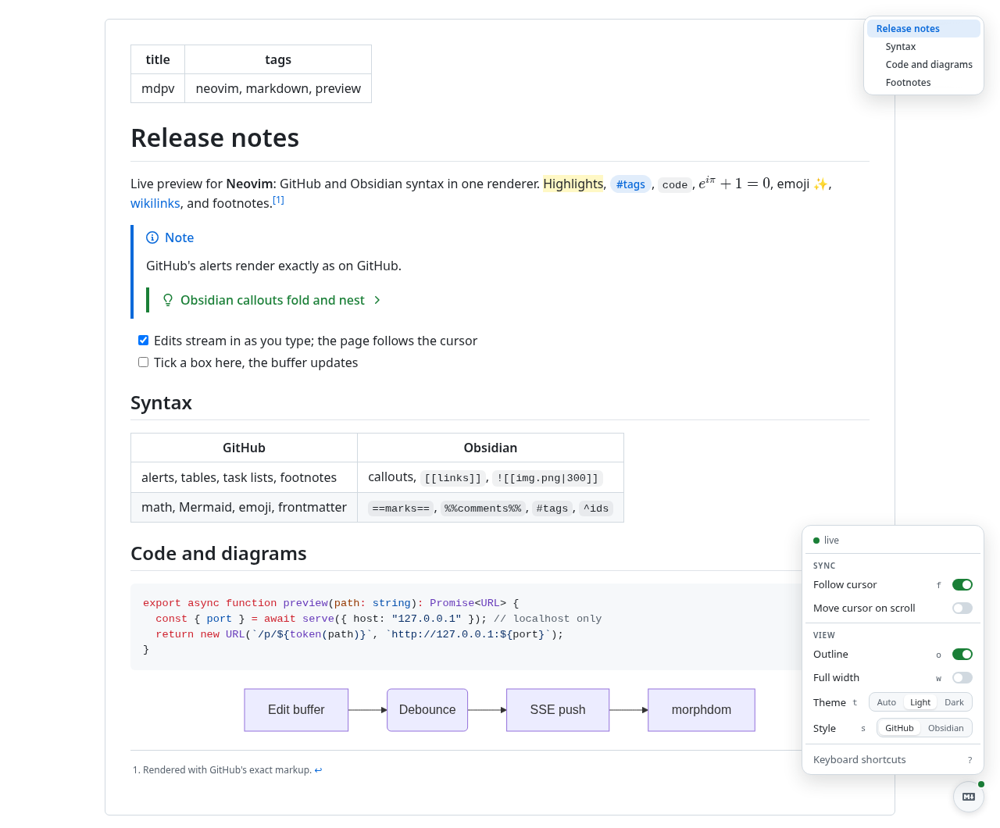

# mdpv.nvim

Live markdown preview for Neovim. GitHub and Obsidian syntax in one
renderer, styled like either. Pure Lua server on `vim.uv`: no Node, Deno, or
Python.



## Features

- **GitHub**: tables, task lists, alerts, footnotes, KaTeX math, Mermaid,
  emoji, frontmatter, sanitized raw HTML; code highlighted by GitHub's own
  grammars and colors ([starry-night](https://github.com/wooorm/starry-night)).
- **Obsidian**: callouts, `[[wikilinks]]`, `![[image|300]]` embeds,
  `==highlights==`, `%%comments%%`, `#tags`, `^block-ids`,
  `^[inline footnotes]`.
- **Styles**: GitHub or Obsidian; light, dark, or auto.
- **Live**: every edit, without flicker; images reload when they change on
  disk.
- **Sync**: the page follows the cursor, double-click jumps back, checkboxes
  toggle the buffer.
- **Reading**: outline, Vim keys, full width; one tab can follow your
  buffers.
- **Light and safe**: Neovim never parses markdown; localhost only,
  token-gated URLs, strict CSP.

## Install

Neovim 0.12+ and a browser.

vim.pack:

```lua
vim.pack.add({
  { src = 'https://github.com/hitori-chan/mdpv.nvim', version = vim.version.range('*') },
})
```

lazy.nvim:

```lua
{ 'hitori-chan/mdpv.nvim', version = '*', cmd = 'Preview', opts = {} }
```

Releases are semver tags; drop `version` to track `main`.

## Usage

| Command | Action |
| --- | --- |
| `:Preview` | open the current buffer's preview |
| `:Preview!` | same, for a buffer outside `filetypes` |
| `:Preview close` | close it |
| `:Preview toggle` | open or close it (`!` forces) |
| `:Preview list` | list previews, URLs, attached tabs |
| `:Preview stop` | close all previews, stop the server |

Lua: `require('mdpv')` has `open(bufnr?, { force? })`, `close(bufnr?)`,
`toggle(bufnr?)`, `url(bufnr?)`, `list()`, `stop()`.

| Page key | Action |
| --- | --- |
| `j` `k` / `d` `u` | scroll / half page |
| `gg` `G` / `]]` `[[` | top, bottom / next, previous heading |
| `o` `w` | outline, full width |
| `t` `s` | cycle theme, style |
| `f` | follow cursor |
| `m` `?` | menu, shortcuts |
| double-click | jump to that line in Neovim |

## Configuration

`setup()` is optional. Defaults:

```lua
require('mdpv').setup({
  host = '127.0.0.1',
  port = 0,                   -- 0 = any free port
  theme = 'auto',             -- 'auto' | 'light' | 'dark'
  style = 'github',           -- 'github' | 'obsidian'
  debounce = 150,             -- ms before pushing an edit
  filetypes = { 'markdown' }, -- previewable without :Preview!
  follow_buffer = false,      -- one tab that follows the current buffer
  auto_close = true,          -- close a preview when its buffer unloads
  auto_stop = true,           -- stop the server after the last preview
  open_browser = true,        -- true | false | { 'cmd', 'args' } | function(url)
  math = true,                -- or KaTeX options: { macros = { ['\\RR'] = '\\mathbb{R}' } }
  mermaid = true,
  emoji = true,
  reload_images = true,       -- reload images that change on disk
  scroll_sync = true,         -- true | false | 'both' (page scroll moves the cursor)
})
```

- `theme` and `style` are initial values; the page's pickers override them
  and save to `stdpath("state")/mdpv-prefs.json`.
- Calling `setup()` again updates open previews; `host` and `port` can't
  change while previews are open.
- Unknown keys warn; invalid values error.

`:help mdpv` has the full reference; `:checkhealth mdpv` checks the install.

## Limitations

- KaTeX, not GitHub's MathJax: near-identical, not glyph-exact.
- Frontmatter nested deeper than one level is hidden.
- Relative links can't reach above the file's directory.
- Linked `.md` files open as static pages; `![[note]]` embeds become links.
- Highlighting covers about 80 common languages; others render plain.

## Development

See [docs/DEVELOPMENT.md](docs/DEVELOPMENT.md).

## License

MIT. Vendored libraries keep their own licenses (`assets/vendor/VERSIONS.txt`).
